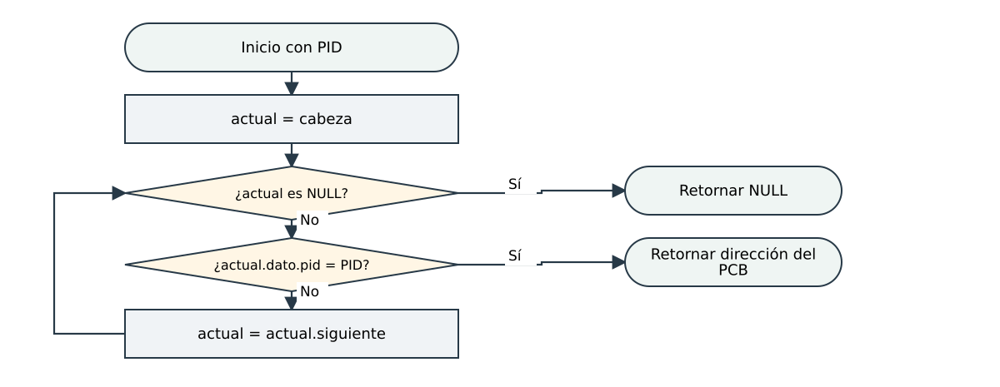
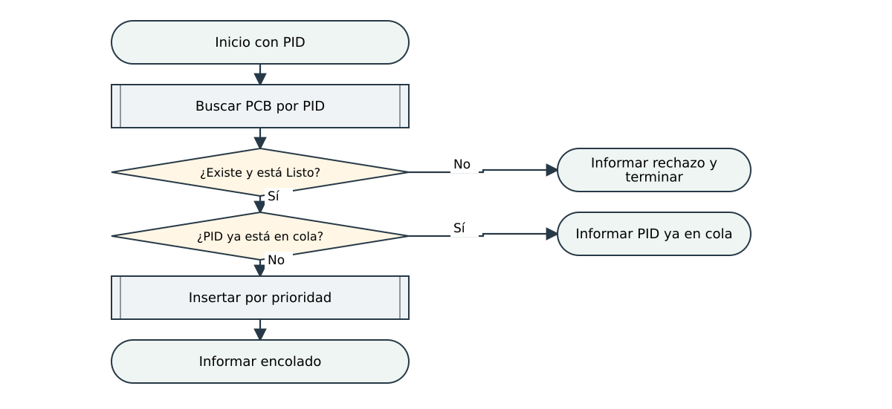
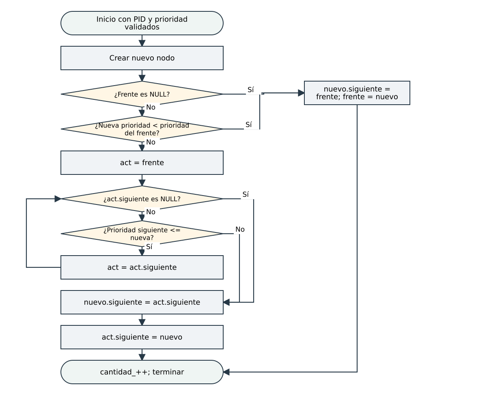
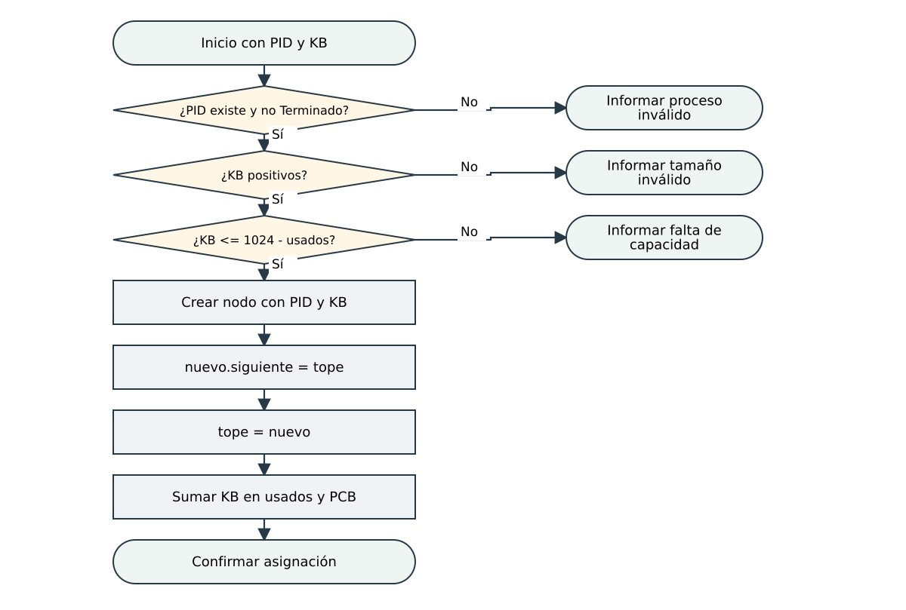
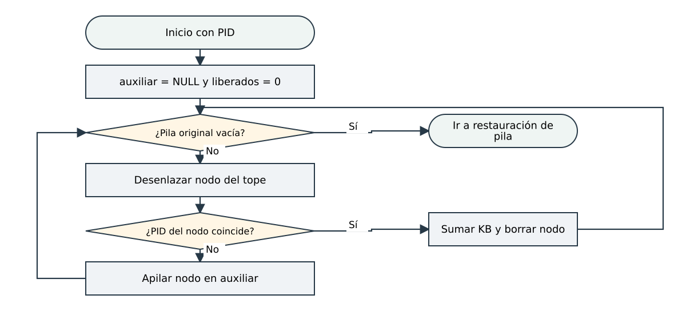
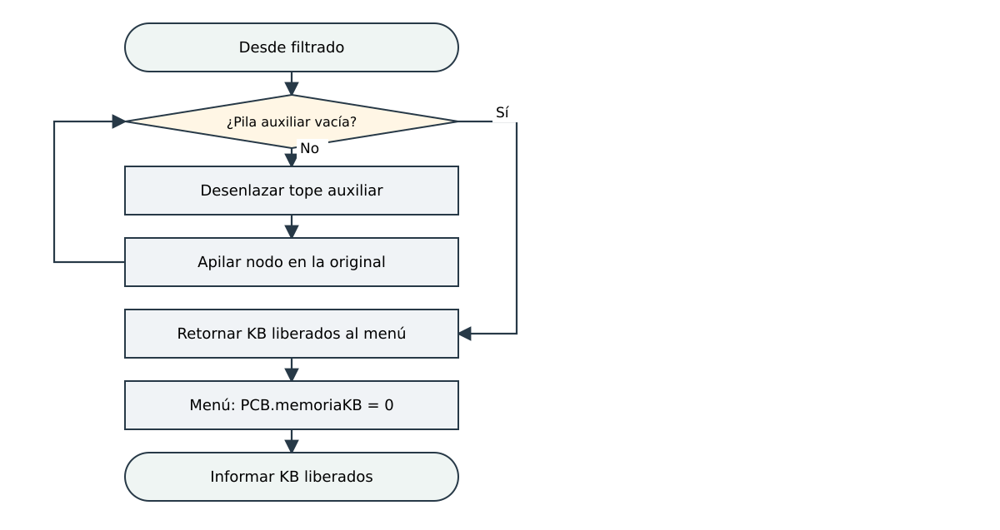
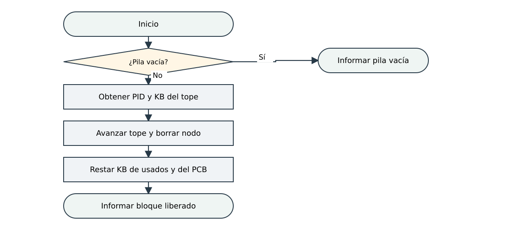
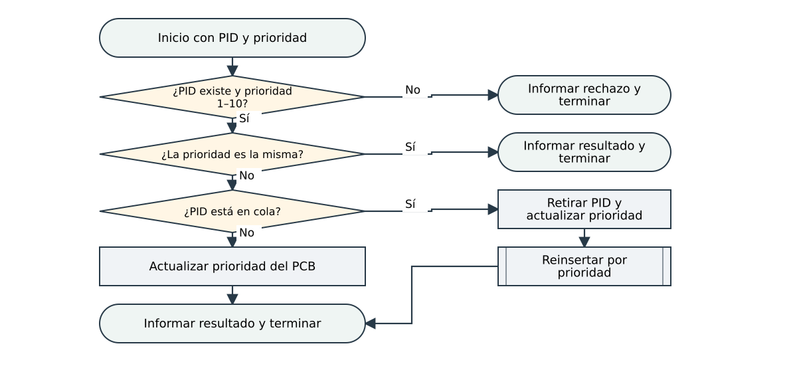

# Flujos complementarios cotejados

Versión integrada del 3/11/2026. Cada pie distingue la operación local y la coordinación del menú.

[Editable diagrams.net](../Flujos_complementarios.drawio) · [Índice de diagramas](../README.md)

## Búsqueda por PID en la lista

NULL indica fin de lista o búsqueda sin resultado. El ciclo recorre nodos, no posiciones de un arreglo.

[SVG editable](02_buscar.svg)

## Validación del encolamiento

La integración permite encolar solo procesos Listo. El método encolar rechaza PID/prioridad inválidos y PID repetido; el recorrido con act está en el flujo siguiente.

[SVG editable](04_encolar_validacion.svg)

## Inserción ordenada con act

El método encolar retorna void y usa cantidad_. La integración valida antes el PID y el estado Listo. Avanzar con <= conserva FIFO entre iguales.

[SVG editable](05_encolar_act.svg)

## Asignación y enlaces del tope

Se admite el total exacto de 1024 KB. Actualizar cada contador una sola vez; identificar qué actualización pertenece a la pila y cuál a la coordinación con el PCB.

[SVG editable](asignar.svg)

## Liberación por PID y pila auxiliar

Al borrar un nodo coincidente, acumular sus KB, restar usadosKB_ y decrementar cantidad_. Los demás nodos se transfieren sin copiarlos. Continuar con restauración.

[SVG editable](08_liberar_filtrar.svg)

## Restauración y contadores

liberarPorPid retorna los KB liberados; los contadores internos ya se actualizaron durante el filtrado. El menú pone memoriaKB en cero. No restar dos veces usadosKB_. La doble inversión conserva el orden.

[SVG editable](09_liberar_restaurar.svg)

## Liberación del tope

Pop es LIFO. La búsqueda del PCB pertenece a la coordinación y cuesta O(n), aunque extraer el nodo de la pila cuesta O(1).

[SVG editable](10_pop.svg)

## Modificación de prioridad

Solicitar la misma prioridad conserva la posición. Una prioridad diferente cuenta como una nueva llegada a ese grupo de prioridad.

[SVG editable](11_prioridad.svg)
