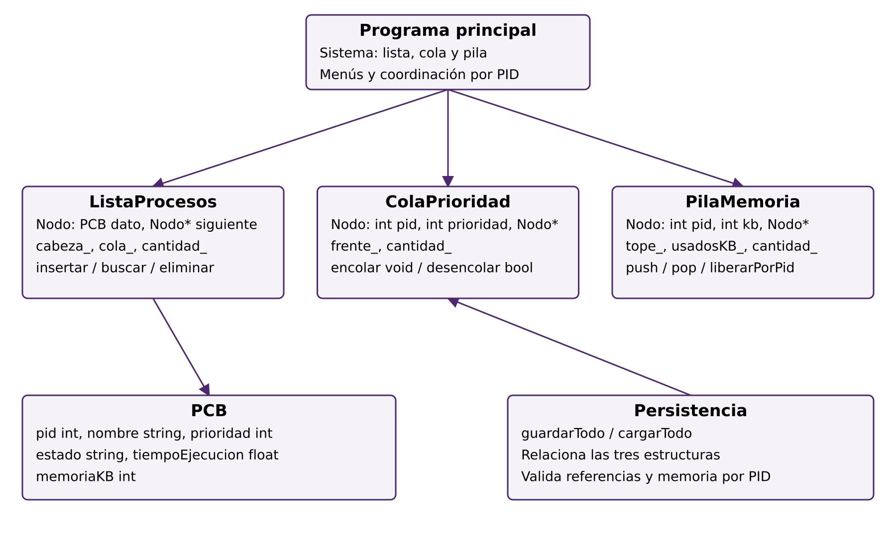
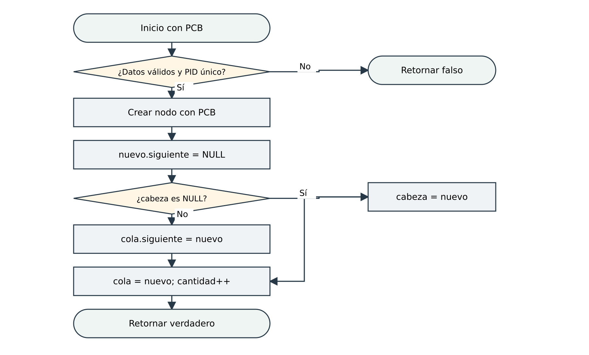
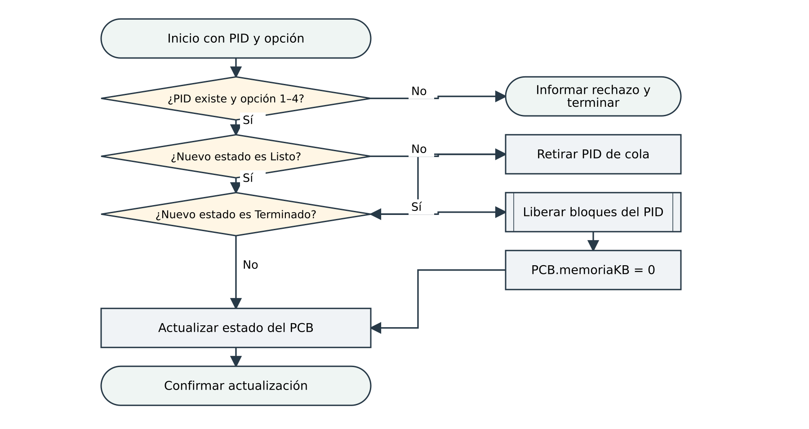

# Diagramas del sistema de gestión de procesos

## Aporte original de Bonifacio

Archivos añadidos por `MarianoBoni33`, según el historial de GitHub. Mauricio confirma que son aportes de Bonifacio. Los originales se conservan:

| Archivo | Contenido | Revisión |
|---|---|---|
| [Imagen 000343](Imagenes/Captura%20de%20pantalla%202026-11-03%20000343.png) | Actividad de insertar proceso | Representa lista enlazada con cabeza y último nodo, aunque el título dice ABB. Usar la adaptación corregida de abajo para el informe. |
| [Imagen 001748](Imagenes/Captura%20de%20pantalla%202026-11-03%20001748.png) | Cambio de estado | Aporta decisiones de existencia, estado válido, retiro de cola y liberación. Es un diagrama de actividad UML; los subprocesos requieren explicación. |
| [Imagen 004226](Imagenes/Captura%20de%20pantalla%202026-11-03%20004226.png) | Clases y relaciones | Aporta módulos, nodos privados y campos. Corregir la lectura: `prioridad` es campo de PCB; las funciones de menú son libres y Sistema agrupa las instancias. |
| [EDD.vpp](VisualParading/EDD.vpp) | Proyecto editable de Visual Paradigm | Disponible para descarga. Se verificó su presencia; no se afirma haber abierto ni validado internamente el proyecto. |

Las tres imágenes coinciden byte por byte con las incrustadas en el informe recibido de Bonifacio. No se duplicaron en otra carpeta como si fueran aportes diferentes.

## Adaptaciones utilizadas en los capítulos

Estas versiones se ajustaron al código integrado del 3/11. Los diagramas de actividad originales permanecen como evidencia del aporte; las adaptaciones documentan las correcciones editoriales y de correspondencia.

- [Organización de clases y módulos](Actualizados/clases.png) · [SVG](Actualizados/clases.svg).
- [Insertar al final de la lista](Actualizados/registrar_lista.png) · [SVG](Actualizados/registrar_lista.svg).
- [Cambiar estado](Actualizados/cambiar_estado.png) · [SVG](Actualizados/cambiar_estado.svg).
- [Flujos editables en diagrams.net](Flujos_integrados.drawio).
- [Representación de lista, cola y pila](Actualizados/estructuras.png), imagen aportada dentro del DOCX de Bonifacio.

La búsqueda de duplicados recorre la lista; la inserción enlaza al final. La cola admite solo Listo. Las antiguas propuestas gráficas del chat no sustituyen estas reglas. La aprobación docente y el ensayo siguen pendientes de evidencia.

## Desarrollo de los subprocesos

[Ocho flujos complementarios cotejados con el código](Complementarios/README.md): búsqueda, encolamiento, memoria, liberación y prioridad. Estos desarrollan los subprocesos mencionados en las figuras del informe.
