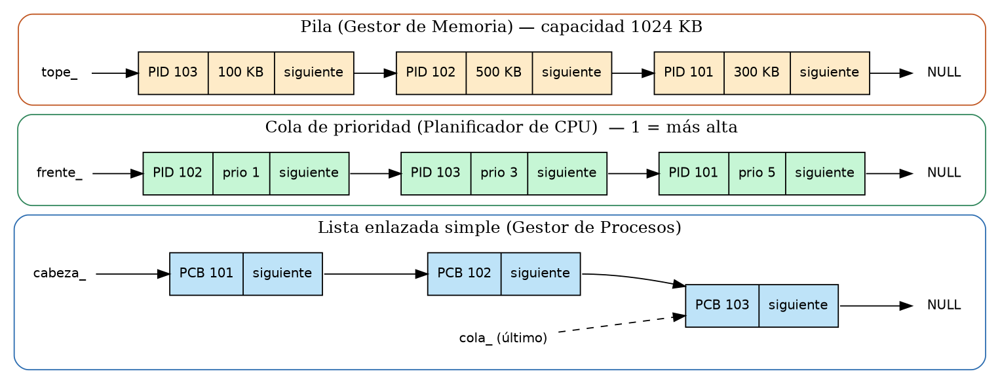

# Capítulo 1 Análisis del problema

## 1.1. Descripción del problema

Un sistema operativo ejecuta muchos procesos al mismo tiempo y necesita controlarlos. Para ello guarda la información de cada proceso (identificador, nombre, prioridad, estado, tiempo de ejecución y memoria asignada) en un registro llamado Bloque de Control de Proceso (PCB). Además, debe decidir qué proceso usa primero el procesador y administrar los bloques de memoria que se asignan a cada uno.

PID significa Process Identifier, identificador de proceso. Es un entero positivo y único entre los procesos del simulador; enlaza el PCB con sus turnos y bloques. PCB significa Process Control Block, bloque de control de proceso. CPU es la unidad central de procesamiento: el programa simula la atención y no administra procesos reales del sistema operativo.

FIFO significa First In, First Out: entre procesos de igual prioridad se atiende primero al que llegó antes. LIFO significa Last In, First Out: pop retira el último bloque apilado. KB expresa la memoria simulada. La interfaz registra un tiempo estimado sin fijar una unidad física ni medir tiempo real de CPU.

Si estas tareas se resuelven con arreglos estáticos, el sistema queda limitado a una capacidad fija: se desperdicia memoria cuando hay pocos procesos y no se pueden registrar más cuando el arreglo se llena. Además, insertar o eliminar en medio de un arreglo obliga a desplazar elementos, y mantener ordenada por prioridad la cola de ejecución exige reordenar constantemente.

Por ello se desarrolla en C++ (Dev-C++) un Sistema de Gestión de Procesos que simula la administración de tareas de un sistema operativo utilizando exclusivamente estructuras de datos dinámicas lineales implementadas desde cero: una lista enlazada que registra los procesos, una cola de prioridad que simula la planificación de la CPU y una pila que administra los bloques de memoria.

## 1.2. Requerimientos del sistema

### Requerimientos funcionales (RF)

| Código | Módulo | Requerimiento |
| --- | --- | --- |
| RF1 | Gestor de Procesos | Registrar un proceso en la lista enlazada con PID, nombre, prioridad (1 a 10, donde 1 es la más alta) y tiempo estimado. El estado inicial es "Listo" y la memoria asignada es 0. |
| RF2 | Gestor de Procesos | Rechazar el registro si el PID ya existe o si algún dato es inválido (unicidad y validación). |
| RF3 | Gestor de Procesos | Buscar un proceso por PID o por nombre y mostrar su información. |
| RF4 | Gestor de Procesos | Eliminar un proceso (cabeza, interior o último). Al eliminarlo se retira de la cola y se liberan sus bloques de memoria. |
| RF5 | Gestor de Procesos | Modificar la prioridad de un proceso; si está en la cola se reubica según su nueva prioridad. |
| RF6 | Gestor de Procesos | Modificar el estado (Listo, Ejecucion, Bloqueado, Terminado). Si deja de estar "Listo" sale de la cola; si pasa a "Terminado" se libera su memoria. |
| RF7 | Gestor de Procesos | Listar todos los procesos registrados. |
| RF8 | Planificador de CPU | Encolar procesos "Listo" en una cola de prioridad: sale primero el de menor valor numérico (prioridad más alta); a igual prioridad, el que llegó primero (FIFO). |
| RF9 | Planificador de CPU | Desencolar y "ejecutar" el proceso del frente: pasa a Terminado y libera su memoria. |
| RF10 | Planificador de CPU | Visualizar la cola actual en orden de ejecución. |
| RF11 | Gestor de Memoria | Asignar un bloque de memoria a un proceso (push) validando que exista, que no esté terminado y que haya memoria libre (capacidad total 1024 KB). |
| RF12 | Gestor de Memoria | Liberar el bloque del tope (pop) o liberar todos los bloques de un PID. |
| RF13 | Gestor de Memoria | Buscar los bloques de un PID y verificar el estado actual de la memoria (usada, capacidad y bloques de base a tope). |
| RF14 | Sistema | Persistencia: guardar y cargar el estado del sistema en archivos de texto (procesos.txt, cola.txt y memoria.txt), validando su consistencia al cargar. |

### Requerimientos no funcionales (RNF)

RNF1 Eficiencia: desencolar y las operaciones locales push y pop son O(1). Insertar un PCB, buscar o eliminar en lista y encolar son lineales en el número de nodos recorridos. Las solicitudes coordinadas añaden las búsquedas del PCB que correspondan.

RNF2 Usabilidad: menú interactivo por consola con submenús por módulo y mensajes comprensibles.

RNF3 Mantenibilidad y modularidad: código comentado y organizado en archivos separados (.h/.cpp) por módulo: PCB, ListaProcesos, ColaPrioridad, PilaMemoria, Persistencia y main.

RNF4 Confiabilidad e integridad: la cola siempre queda ordenada por prioridad, la pila respeta el orden LIFO y el campo memoriaKB de cada PCB coincide con la suma de sus bloques en la pila.

RNF5 Robustez: validación de todas las entradas (se rechaza texto sobrante y valores fuera de rango) y manejo de casos especiales: estructura vacía, PID inexistente, PID repetido y memoria insuficiente.

RNF6 Memoria dinámica exclusiva: implementación con punteros (new/delete), sin contenedores de la STL (<list>, <queue>, <stack>, <vector>). Los destructores liberan todos los nodos.

RNF7 Persistencia: se escriben archivos temporales y se reemplazan los tres destinos de manera secuencial. La carga valida referencias, rangos y memoria por PID. El reemplazo de tres archivos no es atómico y una interrupción puede dejar un conjunto incompleto.

RNF8 Portabilidad: C++ estándar (C++98), compatible con Dev-C++.

## 1.3. Estructuras de datos propuestas

El proyecto exige al menos tres estructuras dinámicas lineales diferentes. Se proponen las siguientes, todas basadas en nodos enlazados por punteros:

| Estructura | Módulo | Contenido y regla de funcionamiento |
| --- | --- | --- |
| Lista enlazada simple (ListaProcesos) | Gestor de Procesos | Cada nodo guarda un PCB completo y un puntero "siguiente". Mantiene los punteros "cabeza_" y "cola_" (último nodo), de modo que enlazar al final no requiere recorrer la lista. Es la única dueña de los PCB. |
| Cola de prioridad (ColaPrioridad) | Planificador de CPU | Lista enlazada ordenada: cada nodo guarda solo el PID y la prioridad (el PCB completo vive en la lista). El "frente_" siempre es el de menor valor numérico. En empates se respeta el orden de llegada (FIFO). |
| Pila (PilaMemoria) | Gestor de Memoria | Cada nodo es un bloque (pid propietario, kb) con puntero "siguiente" hacia el bloque inferior. Se inserta y se retira por el "tope_" (LIFO). Capacidad simulada: 1024 KB. |

Las tres estructuras se relacionan por el PID: el PCB de la lista conecta con su turno en la cola y con sus bloques en la pila. El PCB incluye el campo memoriaKB, que debe coincidir con la suma de los bloques del proceso en la pila.

Figura 1. Lista, cola y pila relacionadas por PID. Aporte recibido de Bonifacio.

## 1.4. Justificación de la elección

Lista enlazada para el Gestor de Procesos: los procesos aparecen y terminan en cualquier momento. Con nodos enlazados solo se reasignan punteros al insertar o eliminar (sin desplazar elementos como en un arreglo) y la capacidad crece o se reduce según los procesos activos. El puntero al último nodo permite agregar al final en O(1).

Cola de prioridad para el Planificador de CPU: un planificador debe atender primero al proceso más importante y, entre iguales, al que llegó antes. La cola con inserción ordenada deja siempre al de mayor prioridad en el frente, de modo que desencolar es O(1).

Pila para el Gestor de Memoria: la asignación de bloques sigue naturalmente el principio LIFO: el último bloque asignado es el primero en liberarse. Push y pop son O(1) y el estado de la memoria se conoce en todo momento.

Cumplimiento de la consigna: las tres estructuras son dinámicas, lineales y diferentes, se implementan desde cero y cada una incluye inserción, eliminación y búsqueda.

Limitación: la búsqueda en la lista es O(n) porque se recorre nodo a nodo; para el alcance del simulador es aceptable.
