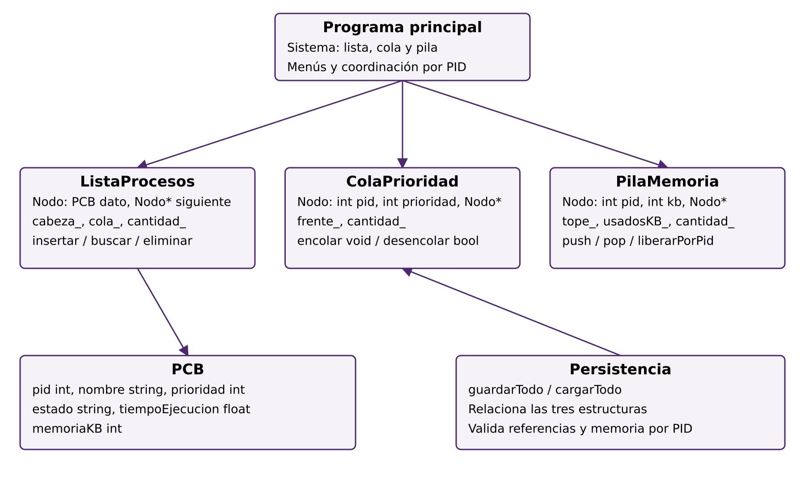
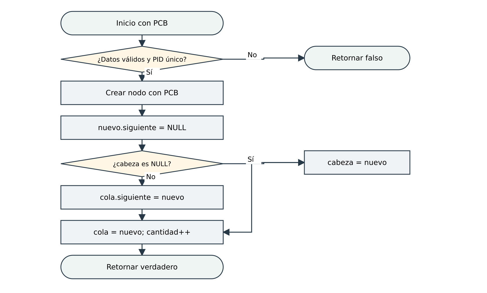
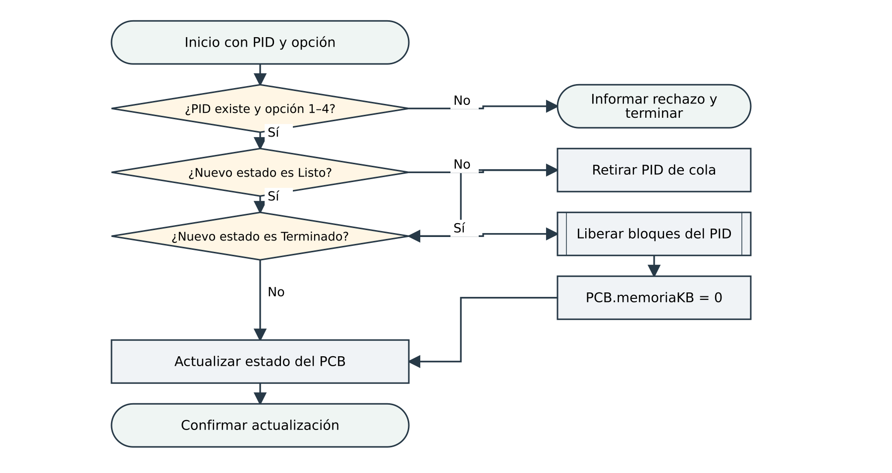

# Capítulo 2 Diseño de la solución

## 2.1. Descripción de estructuras de datos y operaciones

### 2.1.1. Registro PCB y nodos

| Registro / campo | Tipo | Descripción |
| --- | --- | --- |
| PCB.pid | int | Identificador único del proceso (mayor que 0). |
| PCB.nombre | string | Nombre del proceso (no vacío). |
| PCB.prioridad | int | De 1 (más alta) a 10 (más baja). |
| PCB.estado | string | Listo, Ejecucion, Bloqueado o Terminado. |
| PCB.tiempoEjecucion | float | Tiempo estimado ingresado (dato simulado). |
| PCB.memoriaKB | int | Memoria asignada; debe coincidir con la suma de sus bloques en la pila. |
| Nodo (ListaProcesos) | struct privado | Un PCB (dato) y el puntero "siguiente". |
| Nodo (ColaPrioridad) | struct privado | pid, prioridad y el puntero "siguiente". |
| Nodo (PilaMemoria) | struct privado | pid, kb y el puntero "siguiente" (bloque inferior). |

Las funciones de validación pidValido, prioridadValida y estadoValido (archivo PCB.h) centralizan las reglas de los datos.

Un struct agrupa campos relacionados. PCB contiene los datos de un proceso. Cada Nodo privado añade un puntero siguiente que enlaza otro nodo del mismo tipo. cabeza_, frente_ y tope_ permiten acceder a la lista, cola y pila. NULL indica ausencia de nodo; el tipo Nodo de una clase es distinto del Nodo de otra. El struct por sí solo no constituye la estructura: hacen falta enlaces y operaciones sobre ellos.

### 2.1.2. Operaciones de ListaProcesos (Gestor de Procesos)

| Operación | Entrada | Retorno | Descripción |
| --- | --- | --- | --- |
| insertar | p: PCB | bool | Valida los datos, rechaza PID repetido y enlaza el nodo al final usando el puntero cola_. |
| buscarPorPid | pid: int | PCB* | Recorre la lista; retorna el PCB o NULL. |
| buscarPorNombre | nombre: string | PCB* | Retorna la primera coincidencia o NULL. |
| eliminar | pid: int | bool | Elimina cabeza, interior o último; actualiza cola_ si era el último y libera el nodo con delete. |
| recorrer | visitante, ctx | void | Aplica una función a cada PCB (se usa para listar y guardar). |
| liberarTodo<br>tamanio<br>vacia | – | void / int / bool | Libera todos los nodos; consulta la cantidad; indica si está vacía. |

### 2.1.3. Operaciones de ColaPrioridad (Planificador de CPU)

| Operación | Entrada | Retorno | Descripción |
| --- | --- | --- | --- |
| encolar | pid, prioridad | void | Inserción ordenada; ignora un PID repetido. Menor valor al frente; FIFO entre iguales. |
| desencolar | pid&, prioridad& | bool | Retira el frente (el más prioritario). Falso si está vacía. |
| eliminarPid | pid: int | bool | Retira un PID de cualquier posición. |
| contiene | pid: int | bool | Busca si un PID está en la cola. |
| recorrer | visitante, ctx | void | Visita los elementos de frente a final (visualización). |

### 2.1.4. Operaciones de PilaMemoria (Gestor de Memoria)

| Operación | Entrada | Retorno | Descripción |
| --- | --- | --- | --- |
| push | pid, kb | bool | Asigna un bloque en el tope si kb > 0 y hay memoria libre. |
| pop | pid&, kb& | bool | Libera el bloque del tope. Falso si la pila está vacía. |
| liberarPorPid | pid: int | int | Libera todos los bloques de un PID usando una pila auxiliar para conservar el orden de los demás; retorna los KB liberados. |
| totalPorPid / bloquesDePid | pid: int | int | Búsqueda: total de KB y cantidad de bloques de un PID. |
| recorrerDesdeBase | visitante, ctx | void | Visita los bloques de la base al tope (usa recursión). |
| usadosKB<br>libresKB<br>tamanio<br>vacia | – | int / bool | Estado actual de la memoria. |

### 2.1.5. Persistencia

guardarTodo escribe procesos.txt, cola.txt y memoria.txt mediante temporales y reemplazos secuenciales. cargarTodo empieza por procesos y continúa con cola y memoria. Valida PID, estado Listo en cola, prioridad coincidente, capacidad y suma de bloques por PID. La carga fallida deja las estructuras vacías e informa el error; el programa principal termina sin guardar sobre los archivos. No se garantiza un reemplazo atómico de los tres archivos.

## 2.2. Algoritmos principales (pseudocódigo)

### 2.2.1. Pseudocódigo para agregar proceso

```text
ALGORITMO insertar(p: PCB) RETORNA Booleano
 // Paso 1: validar los datos
 SI p.pid <= 0 O p.nombre está vacío O p.prioridad fuera de 1..10 O
    p.estado no es válido O tiempo no finito O tiempo < 0 O memoriaKB < 0 ENTONCES
     RETORNAR Falso
 FIN SI
 // Paso 2: control de unicidad
 SI buscarPorPid(p.pid) != NULO ENTONCES
     RETORNAR Falso
 FIN SI
 // Paso 3: crear el nodo en memoria dinámica
 n <- NUEVO Nodo
 n.dato <- p
 n.siguiente <- NULO
 // Paso 4: enlazar al final usando el puntero al último nodo
 SI cabeza == NULO ENTONCES
     cabeza <- n
     cola <- n
 SINO
     cola.siguiente <- n
     cola <- n
 FIN SI
 cantidad <- cantidad + 1
 RETORNAR Verdadero
FIN ALGORITMO
```

### 2.2.2. Pseudocódigo para cambiar estado del proceso

```text
ALGORITMO cambiarEstado(pid, opcion)       // opcion: 1 Listo, 2 Ejecucion,
                                          // 3 Bloqueado, 4 Terminado
 // Paso 1: localizar el proceso recorriendo la lista
 p <- lista.buscarPorPid(pid)
 SI p == NULO ENTONCES
     MOSTRAR "No existe"
     RETORNAR
 FIN SI
 // Paso 2: validar la opción (rechaza valores fuera de 1..4)
 SI opcion < 1 O opcion > 4 ENTONCES
     MOSTRAR "Valor inválido"
     RETORNAR
 FIN SI
 // Paso 3: la cola solo admite procesos Listos
 SI opcion != 1 ENTONCES
     cola.eliminarPid(pid)
 FIN SI
 // Paso 4: si termina, libera su memoria
 SI opcion == 4 ENTONCES
     pila.liberarPorPid(pid)
     p.memoriaKB <- 0
 FIN SI
 // Paso 5: actualizar el PCB
 p.estado <- estadoCorrespondiente(opcion)
 MOSTRAR "Estado actualizado"
FIN ALGORITMO
ALGORITMO buscarPorPid(pid) RETORNA PCB
 a <- cabeza
 MIENTRAS a != NULO HACER
     SI a.dato.pid == pid ENTONCES RETORNAR a.dato
     a <- a.siguiente
 FIN MIENTRAS
 RETORNAR NULO
FIN ALGORITMO
```

### 2.2.3. Otros algoritmos clave: encolar por prioridad, asignar memoria (push) y liberar por PID

```text
ALGORITMO encolar(pid, prioridad)
 SI pid <= 0 O prioridad fuera de 1..10 O contiene(pid) ENTONCES RETORNAR
 n <- NUEVO Nodo(pid, prioridad, NULO)
 SI frente == NULO O prioridad < frente.prioridad ENTONCES
     n.siguiente <- frente
     frente <- n
 SINO
     a <- frente
     MIENTRAS a.siguiente != NULO Y a.siguiente.prioridad <= prioridad HACER
         a <- a.siguiente          // en empate queda DESPUÉS (FIFO)
     FIN MIENTRAS
     n.siguiente <- a.siguiente
     a.siguiente <- n
 FIN SI
FIN ALGORITMO
ALGORITMO push(pid, kb) RETORNA Booleano
 SI pid <= 0 O kb <= 0 O kb > CAPACIDAD - usadosKB ENTONCES
     RETORNAR Falso                 // memoria insuficiente
 FIN SI
 n <- NUEVO Nodo(pid, kb)
 n.siguiente <- tope
 tope <- n
 usadosKB <- usadosKB + kb
 RETORNAR Verdadero
FIN ALGORITMO
ALGORITMO liberarPorPid(pid) RETORNA Entero
 aux <- NULO; liberados <- 0
 MIENTRAS tope != NULO HACER
     n <- tope; tope <- n.siguiente
     SI n.pid == pid ENTONCES
         liberados <- liberados + n.kb; usadosKB <- usadosKB - n.kb
         ELIMINAR n
     SINO
         n.siguiente <- aux; aux <- n      // mover a la pila auxiliar
     FIN SI
 FIN MIENTRAS
 MIENTRAS aux != NULO HACER                // devolver al orden original
     n <- aux; aux <- n.siguiente
     n.siguiente <- tope; tope <- n
 FIN MIENTRAS
 RETORNAR liberados
FIN ALGORITMO
```

## 2.3. Diagramas de flujo y estructura

### 2.3.1. Diagrama de clases del sistema

El diagrama muestra el registro PCB, las tres clases que implementan las estructuras dinámicas (cada una con su nodo privado), el módulo de persistencia y el programa principal con los menús. La cola y la lista se relacionan por el PID, y la persistencia usa las tres estructuras.



Figura 2. Organización de módulos y datos compartidos. Adaptación cotejada con el código integrado.

### 2.3.2. Diagrama de flujo: agregar proceso



Figura 3. Inserción al final de la lista enlazada. Adaptación cotejada con el código integrado.

### 2.3.3. Diagrama de flujo: cambiar estado de proceso



Figura 4. Cambio de estado coordinado. Adaptación cotejada con el código integrado.

## 2.4. Justificación del diseño

Eficiencia: desencolar y las operaciones locales push y pop cuestan O(1). Enlazar un nodo al final también cuesta O(1), aunque insertar un PCB cuesta O(n) por verificar duplicados. Una solicitud integrada de memoria puede añadir una búsqueda O(n).

Flexibilidad: insertar y eliminar solo reasignan punteros; no hay desplazamientos de datos ni tamaño fijo.

Datos y coordinación: el PCB completo vive en la lista; la cola conserva PID y una copia de prioridad; la pila conserva PID y KB. La coordinación debe actualizar la prioridad duplicada y la memoria del PCB para mantener la consistencia.

Integridad entre módulos: los menús coordinan los cambios de cola, pila y PCB. La carga verifica referencias y memoria por PID. El alcance probado y las limitaciones se detallan en el capítulo 3.

Memoria dinámica: los nodos se crean con new y se liberan con delete. Los destructores llaman a liberarTodo y se prohíbe la copia de las clases. Estas decisiones reducen riesgos de liberación doble; no sustituyen una verificación específica con un detector de memoria.

Modularidad: un par .h/.cpp por módulo, con un contrato común (PCB.h). Esto permitió repartir el trabajo entre integrantes y facilita el mantenimiento.

## 2.5. Estructuras de datos estáticas y dinámicas

|  | Estáticas (arreglos) | Dinámicas (listas, pilas, colas con nodos) |
| --- | --- | --- |
| Tamaño | Fijo, definido al compilar. | Crece y decrece en ejecución. |
| Memoria | Se reserva todo desde el inicio (posible desperdicio). | Se reserva un nodo a la vez con new. |
| Inserción/eliminación en medio | Requiere desplazar elementos. | Solo se reasignan punteros. |
| Acceso | Directo por índice, O(1). | Secuencial, O(n). |
| En este proyecto | No se usan para almacenar procesos, cola ni memoria. | Lista enlazada, cola de prioridad y pila. |

## 2.6. Análisis de complejidad y estructuras de programación utilizadas

### 2.6.1. Complejidad de los algoritmos principales

| Algoritmo | Tiempo | Espacio | Justificación |
| --- | --- | --- | --- |
| ListaProcesos.insertar | O(n) | O(1) | Verificar PID repetido recorre la lista; enlazar al final es O(1). |
| buscarPorPid<br>buscarPorNombre | O(n) | O(1) | Recorrido secuencial en el peor caso. |
| ListaProcesos.eliminar | O(n) | O(1) | Busca el nodo y su anterior, y reenlaza. |
| ColaPrioridad.encolar | O(n) | O(1) | Busca la posición ordenada. |
| ColaPrioridad.desencolar | O(1) | O(1) | Siempre se retira el frente. |
| PilaMemoria.push / pop | O(1) | O(1) | Solo se trabaja con el tope. |
| PilaMemoria.liberarPorPid | O(n) | O(1) | Recorre la pila una vez y devuelve los bloques ajenos (reenlaza nodos, sin copiar). |
| PilaMemoria.recorrerDesdeBase | O(n) | O(n) | La recursión usa la pila de llamadas, una por bloque. |
| guardarTodo / cargarTodo | O(n + q + m) / O(n² + q·n + q² + m·n) | O(m) por recorrido recursivo | Guardar recorre las estructuras. Cargar busca duplicados/PID, inserta la cola y compara memoria por cada proceso. |

Sean n procesos, q turnos y m bloques. El espacio de los nodos es O(n + q + m); el recorrido recursivo de la pila usa además O(m) de pila de llamadas. Las operaciones locales y las solicitudes coordinadas se analizan por separado.

### 2.6.2. Estructuras de programación empleadas

while: es la estructura de repetición principal. Se usa para recorrer las listas hasta encontrar un dato o llegar a NULL (por ejemplo, buscarPorPid: "mientras haya nodo, comparar el PID y avanzar") y para repetir los menús hasta que el usuario elija 0. Se eligió porque no se sabe de antemano cuántos nodos hay; la repetición depende de una condición y no de un contador.

switch: se usa en los menús para ejecutar la función correspondiente a la opción elegida. Es más claro que una cadena larga de if cuando hay varias opciones numeradas.

if / else: se usan para manejar casos especiales y validar datos: lista vacía, PID inexistente, PID repetido, memoria insuficiente, entrada inválida. Permiten que el programa responda con un mensaje claro en lugar de fallar.

Recursión: se usa una sola vez, en PilaMemoria::recorrerRec, para mostrar los bloques de la base al tope: la función baja hasta el último nodo y al volver visita cada bloque. Se eligió porque la pila solo enlaza hacia abajo y la recursión invierte el recorrido sin estructuras adicionales.

Punteros a función (visitante): las estructuras reciben una función que se aplica a cada elemento (recorrer). Así la lista, la cola y la pila no dependen de cómo se imprime o guarda cada dato, y se reutilizan para mostrar en pantalla y para escribir en archivos.

Operador condicional (? :): se usa para elegir entre dos valores en una sola línea, por ejemplo el estado según la opción.

## 2.7 Flujos complementarios de las operaciones

El repositorio incluye ocho flujos complementarios cotejados con esta versión: búsqueda por PID; validación de encolamiento; recorrido act para inserción ordenada; asignación; filtrado y restauración de bloques por PID; pop; y cambio de prioridad. Los archivos SVG, PNG y el editable diagrams.net están enlazados en Diagramas/Complementarios/README.md. Cada pie identifica las actualizaciones de contadores para evitar duplicarlas entre la estructura y el menú.
