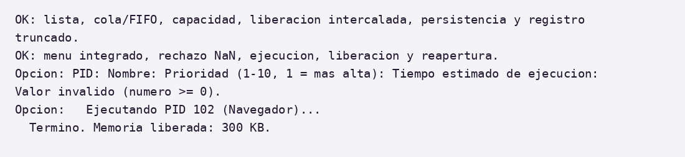

# Capítulo 3 Solución final

La versión integrada incorpora los archivos recibidos en el paquete enviado por Isaí el 3 de noviembre y las correcciones de validación descritas en este capítulo. Las pruebas siguientes se ejecutaron localmente con g++ en Linux. La comprobación en Dev-C++ y en el equipo de exposición sigue pendiente.

## 3.1 Código limpio comentado y estructurado

El código completo y sus cambios se consultan en el repositorio. Los encabezados están en include, las implementaciones en src y la coordinación del menú en main.cpp. Los originales recibidos se conservan en aportes para mantener la trazabilidad.

| Archivo o carpeta | Responsabilidad |
| --- | --- |
| include/PCB.h | PCB, constantes de estado y validadores |
| include y src/ListaProcesos | Lista con cabeza y último nodo; insertar, buscar y eliminar |
| include y src/ColaPrioridad | Cola ordenada, prioridad menor primero y empate FIFO |
| include y src/PilaMemoria | Bloques, capacidad 1024 KB y liberación por PID |
| include y src/Persistencia | Guardar y cargar los tres archivos |
| main.cpp | Entrada validada, menús y coordinación de las estructuras |
| tests y Makefile | Compilación C++98 y pruebas reproducibles |

Fuente y navegación: https://github.com/cMauricioAngel-UC/edd-gestion-procesos

Compilación local: make. Verificación: make test. En Dev-C++ debe crearse un proyecto con main.cpp y los cuatro archivos .cpp de src, añadiendo include al directorio de búsqueda de cabeceras. La ejecución usa como carpeta de datos el directorio de trabajo del programa.

### 3.1.1 Contratos y correcciones de integración

PCB declara float tiempoEjecucion. La cola declara void encolar(int pid, int prioridad), bool desencolar(int& pid, int& prioridad) y contador cantidad_. Estas firmas sustituyen las discrepancias del borrador anterior. Las validaciones rechazan NaN, PID o prioridad inválidos y filas incompletas o con campos sobrantes en cola y memoria. La cabecera recibida de cola se describe como referencia; el registro de aportes acredita la recepción del paquete sin presumir autoría exclusiva de todo su contenido.

## 3.2 Pruebas de validación e integración

El registro reproducible está en docs/evidencias/pruebas-integracion-20261103.txt. Cada ejecución de tests/ejecutar.py usa directorios temporales para aislar los datos. Los resultados se refieren a la versión integrada y corregida, no a una ejecución en Dev-C++.

| Caso | Preparación y comprobación | Resultado observado |
| --- | --- | --- |
| Lista | PID repetido; búsqueda por nombre; eliminar interior, último y cabeza; reinsertar | Las aserciones finalizaron correctamente |
| Cola y FIFO | 101(3), 102(1), 103(3), repetido 101; prioridad 11 | Orden 102 → 101 → 103; sin duplicar ni aceptar prioridad 11 |
| Eliminación de cola | Cola nueva 102 → 101 → 103; eliminar 101 | Salidas 102 y 103 |
| Capacidad | 400 + 300 + 324 KB; solicitar 1 KB más | 1024 aceptados; exceso rechazado |
| Liberación por PID | Bloques 101, 102, 101 y 103 intercalados | Se retira 101 y se conserva el orden relativo de los demás |
| Persistencia | Nombre con espacios, tiempo 3.5, memoria 256 y cola con empate | Se recuperan nombre, tiempo, memoria y orden FIFO comprobados |
| Archivo inválido | cola.txt con un PID sin prioridad | Carga rechazada y estructuras vacías |
| Menú integrado | Registrar 101 y 102; asignar 300 KB a 102; ejecutar y reabrir | 102 termina y libera 300 KB; al reabrir tiene memoria cero |
| Dato no finito | Introducir nan como tiempo | Entrada rechazada |

Figura 5. Extracto del registro real de pruebas automatizadas en Linux. El archivo de texto conserva la salida de compilación y ejecución.

## 3.3 Manual de usuario

### 3.3.1. Requisitos e inicio

Compilar el proyecto en el entorno configurado o ejecutar el binario generado. En esta revisión se comprobó g++ con C++98; las teclas o comandos de Dev-C++ dependen de su instalación.

Al iniciar, si existen procesos.txt, cola.txt y memoria.txt en la misma carpeta, se carga automáticamente el estado anterior. Si no existen, el sistema inicia vacío.

Todas las opciones se eligen escribiendo el número del menú y presionando ENTER. Si se ingresa un valor inválido, el sistema lo informa y vuelve a mostrar el menú.

### 3.3.2. Menú principal

| Opción | Función | Descripción |
| --- | --- | --- |
| 1 | Procesos | Abre el submenú de la lista enlazada. |
| 2 | Planificador | Abre el submenú de la cola de prioridad. |
| 3 | Memoria | Abre el submenú de la pila. |
| 4 | Guardar ahora | Guarda procesos, cola y memoria en los tres archivos .txt. |
| 0 | Salir | Guarda automáticamente y cierra el programa. |

### 3.3.3. Submenú Procesos

1 Registrar: pide PID (entero positivo y único), nombre, prioridad (1 a 10; 1 es la más alta) y tiempo estimado. El estado inicial es "Listo".

2 Listar: muestra todos los procesos con su prioridad, estado, tiempo y memoria asignada.

3 / 4 Buscar por PID / por nombre: muestra los datos del proceso (por nombre, la primera coincidencia).

5 Cambiar prioridad: pide PID y nueva prioridad; si el proceso estaba en la cola, se reubica automáticamente.

6 Cambiar estado: elegir 1 Listo, 2 Ejecucion, 3 Bloqueado o 4 Terminado. Si el nuevo estado no es Listo, el proceso sale de la cola; si es Terminado, libera su memoria.

7 Eliminar: retira el proceso de la cola, libera sus bloques de memoria y lo elimina de la lista.

### 3.3.4. Submenú Planificador

1 Encolar proceso: agrega a la cola un proceso existente en estado "Listo", según su prioridad.

2 Mostrar cola: muestra el orden en que se ejecutarán los procesos (el primero es el de mayor prioridad).

3 Ejecutar siguiente: retira el proceso del frente, simula su ejecución, lo marca como Terminado y libera su memoria.

### 3.3.5. Submenú Memoria

1 Asignar bloque (push): pide PID (debe existir y no estar terminado) y los KB. Falla si no hay memoria libre (capacidad total 1024 KB).

2 Liberar tope (pop): libera el último bloque asignado.

3 Liberar todos los bloques de un PID: libera la memoria de un proceso sin alterar el orden de los demás bloques.

4 Buscar bloques de un PID: muestra cuántos bloques y cuántos KB tiene un proceso.

5 Mostrar memoria: muestra la memoria usada y los bloques de la base al tope.

### 3.3.6. Mensajes frecuentes

| Mensaje | Causa / solución |
| --- | --- |
| Valor inválido (rango a..b) | Se escribió texto o un número fuera del rango indicado. Ingrese un número dentro del rango. |
| Error: PID repetido o datos inválidos | Ya existe un proceso con ese PID o algún dato es inválido. Use otro PID. |
| No existe | El PID no está registrado. Verifique con "Listar". |
| Solo se encolan procesos Listos | El proceso está Bloqueado o Terminado; cámbielo a Listo para encolarlo. |
| Memoria insuficiente | El bloque pedido supera la memoria libre. Libere memoria (pop o liberar por PID). |
| Error al cargar datos... | Preserve una copia de los archivos, revise el mensaje y corrija el conjunto completo antes de reiniciar. |

## 3.4 Limitaciones y comprobaciones pendientes

El guardado sustituye los tres archivos secuencialmente; los temporales no aseguran una transacción atómica ni recuperación frente a una interrupción. cargarTodo vacía las estructuras antes de leer y vuelve a vaciarlas ante un error. recorrerDesdeBase usa recursión O(m), por lo que una cantidad extrema de bloques puede agotar la pila de llamadas. No se ha realizado en esta revisión un ensayo en el equipo de exposición ni una verificación con sanitizadores. Los resultados del informe original que no se reprodujeron se mantienen solo como reportados en dicho original.
